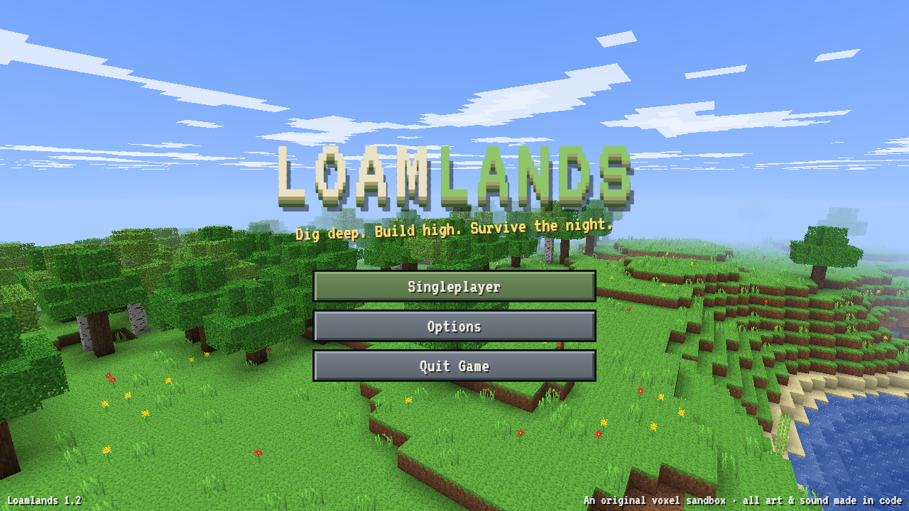

# Claude Fable 5.2 vs Opus 5.5 made a block-building survival game

Claude Fable 5.2 and Claude Opus 5.5 got the same prompt and the same time to make a block-building survival game. Play both in your browser. Every file in `fable/` and `opus/` was written by the AI. The phone controls in [`touch.js`](touch.js) were added by us after the video (see below).

Watch the video: https://youtu.be/jFr2s1PYAnc

Play page: https://modelbehavioryt.github.io/fable-vs-opus-block-game/

| Made by | Game | Play | Code |
|---|---|---|---|
| Claude Fable 5.2 | **Loamlands** | [Play now](https://modelbehavioryt.github.io/fable-vs-opus-block-game/fable/) | [`fable`](fable) |
| Claude Opus 5.5 | **Blockhaven** | [Play now](https://modelbehavioryt.github.io/fable-vs-opus-block-game/opus/) | [`opus`](opus) |

Controls: WASD to move, mouse to look, Space to jump, left click to break or hit, right click to place. Near a villager, press
T (or the Trade button) to trade.

Phone and tablet: turn the phone sideways. Left thumb moves (push all the way up to sprint), right thumb drags to look, tap a
mob to hit it, tap anywhere else to place or use, hold to break. Buttons for Jump, Hit, Use, Sneak, Bag and pause; tap the
hotbar to pick a slot.

## Phone controls (added after the video)

Neither model was asked for touch controls, so a viewer on a phone couldn't play. [`touch.js`](touch.js) adds them without
changing either game's code: it turns touches into the keyboard and mouse events the games already use, and shrinks the menus
to fit a phone screen. With a mouse and keyboard it stays switched off, so desktop play is exactly as the models made it. The
only change inside `fable/` and `opus/` is one `<script>` line in each `index.html`.

To run one locally, serve the whole folder over http (for example `npx serve .`) and open `/fable/` or `/opus/` in Chrome.

## Viewer update (Nov 23)

A viewer asked for fixes and new stuff, so Claude added them to both games after the video:

- Attacking mobs fixed: tap a mob on a phone to hit it, and in Blockhaven tall grass and flowers no longer block hits.
- A Trade button (or T) appears when you're near a villager, with a proper trade screen.
- Redrawn textures for every block and item.
- New biomes (Blossom Grove, mushroom fields, Frost Spires), new mobs and new blocks in each game.

The versions from the video are in the git history at commit `d51061e`.

## How the test worked

- Same prompt for both, started on the same second, about two hours each. The prompt is in `prompts/`.
- Both ran in Claude Code, fully on their own. No human help.

## Credits and licenses

- The code the AI wrote is released under the MIT license (see [LICENSE](LICENSE)).
- All textures, models and sounds are made in code by the AI. three.js is MIT.
- This is a fan-made AI experiment. It isn't affiliated with or endorsed by the makers of the games that inspired it, and it uses
  none of their names, characters or files.

More AI-made games: [Claude vs ChatGPT open-world game](https://github.com/ModelBehaviorYT/claude-vs-chatgpt-ai-games)
