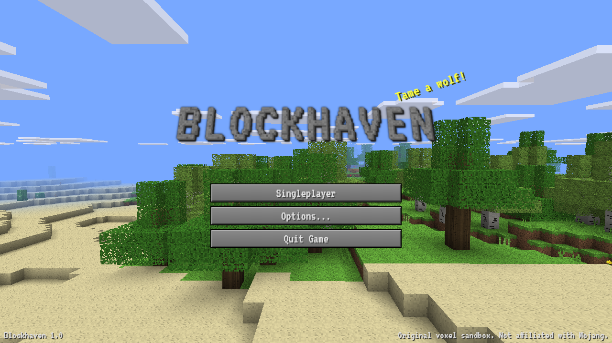

# Claude Fable 5.2 vs Opus 5.5 made a block-building survival game

Claude Fable 5.2 and Claude Opus 5.5 got the same prompt and the same time to make a block-building survival game. Play both in your browser. Every file here was written by the AI.

Watch the video: https://youtu.be/jFr2s1PYAnc

Play page: https://modelbehavioryt.github.io/fable-vs-opus-block-game/

| Made by | Game | Play | Code |
|---|---|---|---|
| Claude Fable 5.2 | **Loamlands** | [Play now](https://modelbehavioryt.github.io/fable-vs-opus-block-game/fable/) | [`fable`](fable) |
| Claude Opus 5.5 | **Blockhaven** | [Play now](https://modelbehavioryt.github.io/fable-vs-opus-block-game/opus/) | [`opus`](opus) |

Controls: WASD to move, mouse to look, Space to jump, left click to break, right click to place.

To run one locally, serve the folder over http (for example `npx serve fable`) and open it in Chrome.

## How the test worked

- Same prompt for both, started on the same second, about two hours each. The prompt is in `prompts/`.
- Both ran in Claude Code, fully on their own. No human help.

## Credits and licenses

- The code the AI wrote is released under the MIT license (see [LICENSE](LICENSE)).
- All textures, models and sounds are made in code by the AI. three.js is MIT.
- This is a fan-made AI experiment. It isn't affiliated with or endorsed by the makers of the games that inspired it, and it uses
  none of their names, characters or files.

More AI-made games: [Claude vs ChatGPT open-world game](https://github.com/ModelBehaviorYT/claude-vs-chatgpt-ai-games)
